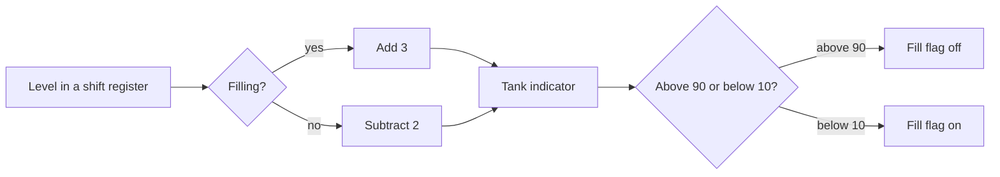

# Water Tank Level Control in LabVIEW

Two LabVIEW VIs that simulate a water tank: the level on a tank indicator rises to 90 and falls back to 10, over and over, until you press Stop. Self-study project, August 2024, following a LabVIEW tutorial.

This repository is a project showcase, not a maintained library.

## Demo

No recording yet. Running either VI shows the front panel with the tank indicator filling and draining, and a Stop button.

## Features

| VI | How the level moves | How it is built |
|---|---|---|
| [`Water Tank 1.vi`](Water%20Tank%20Level%20Control/Water%20Tank%201.vi) | Fills from 0 in steps of 3 every 100 ms until it passes 90, then drains in steps of 5 every 300 ms until it falls below 10, and repeats | A flat sequence of two while loops inside an outer loop. The fill loop keeps the level in a shift register; the drain loop reads and writes the tank through a Value property node |
| [`Water Tank 2.vi`](Water%20Tank%20Level%20Control/Water%20Tank%202.vi) | Rises by 3 or falls by 2 every 100 ms, switching direction at the same limits | One while loop with a shift register. A Boolean fill flag picks the step through a Select; two case structures set the flag off above 90 and on below 10 |

The second VI does the same job in a single loop, so the Stop button answers within 100 ms instead of waiting for a full fill-and-drain cycle.

## Installation and getting started

Prerequisites: [LabVIEW](https://www.ni.com/en/support/downloads/software-products/download.labview.html) 2024 Q3 or later (the VIs are saved in that version and do not open in older ones). The Community Edition is enough; no toolkits or hardware are needed.

```bash
git clone https://github.com/naimulnashid/labview-water-tank-level-control.git
```

Open `Water Tank Level Control/Water Tank.lvproj` in LabVIEW, or open either VI directly.

No releases are published: the VIs run from source.

## Configuration

No configuration needed. The limits (10 and 90), step sizes and loop delays are constants on each block diagram.

## Usage

1. Open a VI and click **Run** (the arrow on the toolbar).
2. Watch the tank indicator fill and drain. In `Water Tank 2.vi` the Boolean indicator shows when the tank is filling.
3. Click **Stop** on the front panel to end the run.

## Tech stack and architecture

LabVIEW graphical programming: while loops, a flat sequence structure, shift registers, property nodes, case structures and the Select function, with a slide indicator styled as a tank.



The diagram shows `Water Tank 2.vi`. Each loop iteration waits 100 ms.

## Security and privacy

The VIs only simulate a tank on screen. They read no files, open no network connections and drive no hardware.

## Development

The project is complete and not under development. On 2026-11-22 the block diagrams were read from the saved files to write this README; the VIs were not run.

## Credits, license and support

- Built while following a LabVIEW tutorial on simulating a water tank.
- No license is granted for this repository: it is shared to show the work, not for reuse.
- This is a personal showcase, so issues and pull requests are not monitored.
